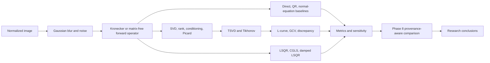
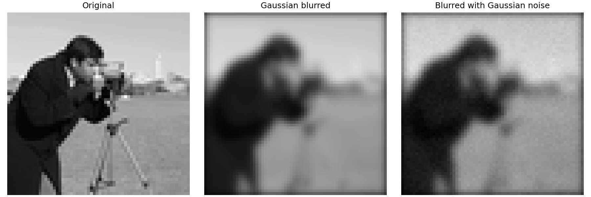
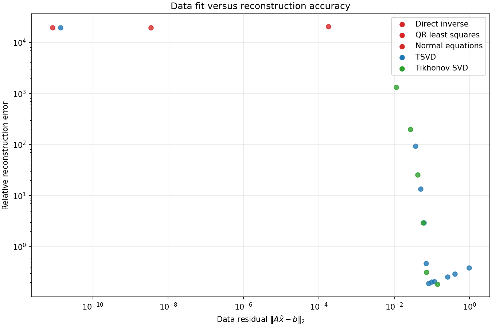
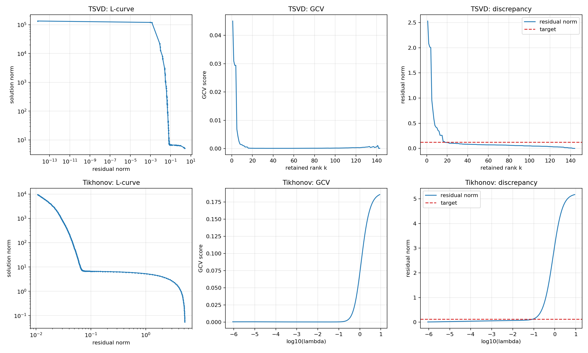
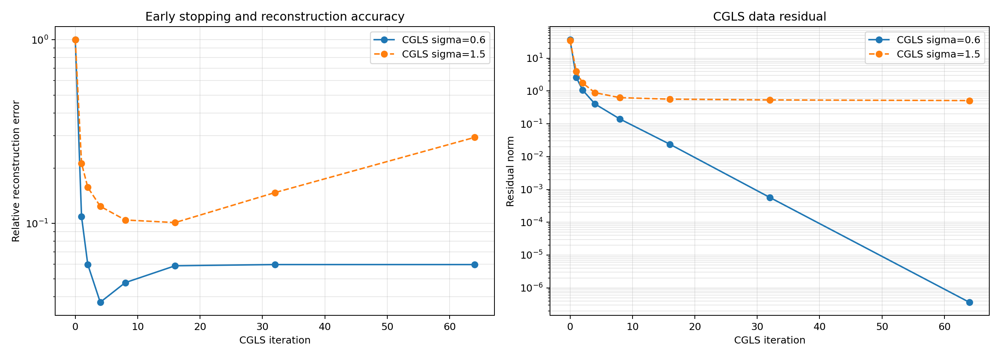
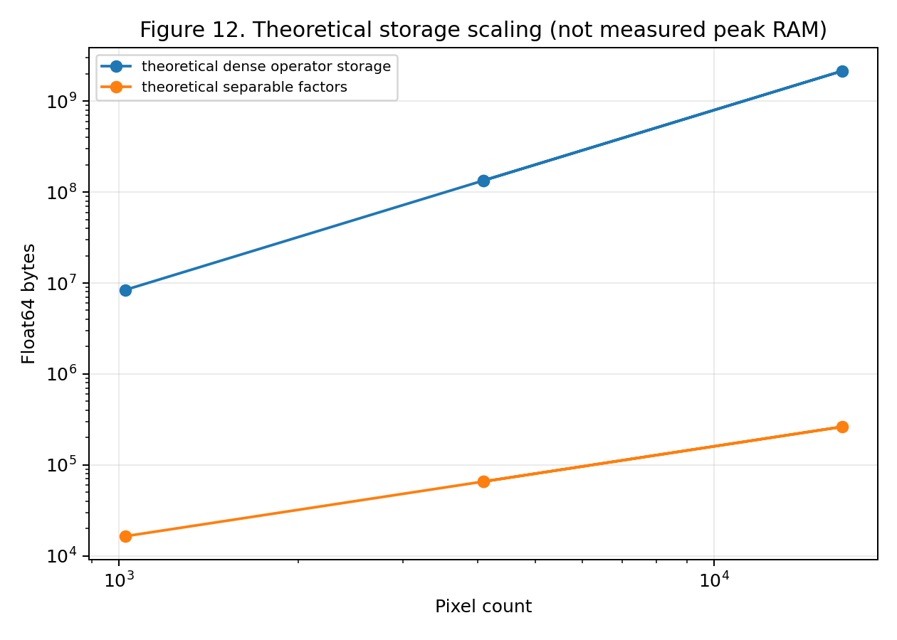

# Numerical Stability and Regularization in Image Deblurring

> A completed numerical study of ill-posed inverse problems, spectral regularization, and matrix-free image reconstruction.

## Contents

- [Problem](#problem)
- [Mathematical foundations](#mathematical-foundations)
- [Research results](#research-results-and-observations)
- [Architecture](#architecture)
- [Reproduction](#reproduction)

## Problem

Image deblurring estimates a sharp image from a blurred, noisy observation:

```math
b = Ax + \epsilon
```

$x$ is the unknown image, $A$ the blur operator, $b$ the observation, and $\epsilon$ additive Gaussian noise. Blur suppresses detail and can make $A$ severely ill-conditioned. Direct inversion may then amplify noise, so a small residual does not guarantee an accurate reconstruction.

## Mathematical foundations

For an image $X$ of shape $r\times c$, this project uses **C-order** vectorization. Its zero-boundary Gaussian model is

```math
Y = B_y X B_x^T
```

```math
\mathrm{vec}_C(Y) = (B_y \otimes B_x)\mathrm{vec}_C(X)
```

Truncated boundary kernels are deliberately not renormalized. The matrix-free adjoint is

```math
\mathrm{vec}_C(B_y^T Z B_x)
```

The spectral analysis uses

```math
A = U\Sigma V^T
```

which exposes weak singular directions that amplify noise. TSVD uses

```math
x_k = \sum_{i=1}^{k}\frac{u_i^T b}{\sigma_i}v_i
```

and Tikhonov uses

```math
x_\lambda = \arg\min_x\left(\|Ax-b\|_2^2 + \lambda^2\|x\|_2^2\right)
```

The same $\lambda$ convention is used by damped LSQR. L-curve, GCV, and discrepancy selection use only operator/observation evidence, not ground truth. Implemented metrics are relative reconstruction error, MSE, PSNR, SSIM, residual norm, and relative residual:

```math
\text{small residual} \not\Rightarrow \text{accurate reconstruction}
```

See the [methodology reference](report/methodology_reference.md) for equations, filter factors, stopping rules, and storage definitions.

## Key Research Takeaways

- In the shared 12×12 baseline, near-zero residuals coexist with relative reconstruction errors near `1.95e4`; data fit is not image accuracy.
- Weak singular directions explain this sensitivity: their inverse weights amplify observational noise.
- TSVD and Tikhonov stabilize reconstruction by spectral filtering, but necessarily introduce bias.
- Automatic selection is not fail-safe: TSVD-GCV selected rank 142 with error `17317.138...` on the saved 12×12 case.
- Iteration count is a regularization decision: Phase 7 trajectories show semiconvergence.
- Matrix-free factors reduce stated operator storage, but not every arithmetic or working-memory cost.
- Phase 8 compatibility controls distinguish strict evidence from descriptive historical observations.

## Research workflow



## Research Results and Observations

All 285 artifacts under `results/` were inspected before this README was written. Phase 8 distinguishes strict-compatible comparisons from descriptive unknown-configuration evidence.

| Finding | Evidence | Interpretation |
|---|---|---|
| Direct inverse and QR errors are about `1.95e4` with near-zero residuals; normal equations are about `2.03e4`. | [baseline table](results/metrics/phase8/phase8_table1_baseline_inverse_methods.csv) | Data fit alone can be catastrophic. |
| The 8x8 spectral summary has condition number about `1.77e6`; the Phase 5 12x12 study reports about `5.68e7`. | [SVD summary](results/metrics/phase3_svd_summary.csv) | Conditioning depends on configuration and tolerance. |
| Tikhonov `lambda=0.1` has error `0.185931...`. | [regularization table](results/metrics/phase8/phase8_table2_regularization_methods.csv) | It is descriptive, not a controlled winner. |
| TSVD-GCV chooses rank 142 with error `17317.138...` and residual `0.0013785...`. | [selection table](results/metrics/phase8/phase8_table3_parameter_selection.csv) | A retained noise-dominated selection failure. |
| Eight Phase 7 equal-budget rows are strict-compatible. | [iterative table](results/metrics/phase8/phase8_table5_iterative_solver_comparison.csv) | Histories remain separate from independent outcomes. |

### Classical inversion: why residuals failed

**Observation.** Direct inverse and QR least squares each have error around `1.95e4` with residuals near numerical zero; normal equations have error around `2.03e4`. **Explanation.** An ill-conditioned blur has weak singular directions, so the inverse multiplies noise by `1/sigma_i`. QR solves least squares more stably than normal equations computationally, but neither changes the underlying ill-posed problem. **Interpretation.** Minimizing `||Ax-b||` can reproduce noisy data while missing the original image. These are descriptive 12×12 observations, not a universal method ranking.

### Spectral diagnosis: what conditioning revealed

**Observation.** The Phase 3 8×8 operator has condition number about `1.77e6`; a different 12×12 Phase 5 configuration reports about `5.68e7`. Picard/noise diagnostics record the small-singular-value regime where transformed noise becomes consequential. **Explanation.** Singular values measure the gain in orthogonal image directions. Their decay produces a large inverse gain in weak directions. **Qualification.** Condition numbers depend on image shape, blur, boundary convention, and rank tolerance, so these values explain their own configurations rather than form a direct cross-case ranking.

### Regularization: stabilization, not perfect recovery

**Observation.** Phase 4 stores stable TSVD and Tikhonov outcomes alongside unstable high-rank solutions. Tikhonov `lambda=0.1` has saved error `0.185931...`, residual `0.138871...`, and SSIM `0.855474...`. **Explanation.** TSVD discards weak spectral components; Tikhonov smoothly attenuates them. Both reduce variance/noise amplification at the cost of bias and lost detail. **Qualification.** The lambda=0.1 result is `descriptive_unknown_configuration` in Phase 8, so it is evidence of a trade-off, not a controlled winner.

### Parameter selection: valid criteria can still fail

**Observation.** On the saved 12×12, sigma 1.5, seed 42 case, TSVD-GCV selected rank 142, residual `0.001378517...`, and relative error `17317.138...`. **Explanation.** GCV is an observation-only criterion; on this spectrum/noise realization it admits a noise-dominated weak direction. L-curve and discrepancy selections in the same saved table choose ranks 24 and 18 with errors about `0.2020` and `0.2070`. In Phase 6's 6×6 case, Tikhonov-GCV selected lambda `6.93e-05`, yielded error `27.89`, and was flagged unstable, while discrepancy and L-curve were not flagged. **Interpretation.** Automatic selection needs stability evaluation; neither success nor failure in one grid establishes universal reliability.

### Robustness and sensitivity: controlled but limited evidence

Phase 6 varies five noise seeds, blur sigma `0.8`, `1.5`, and `2.2`, and resolutions 6×6, 12×12, and 16×16. Individual raw cases and pre-aggregated summaries are kept separate. The normal-equation noise group has mean relative error about `7.45e4`, five unstable unique cases, and small mean residual. These experiments establish sensitivity within a small controlled grid; they do not supply broad statistical generalization.

### Matrix-free iteration: scalability and semiconvergence

Phase 7 validates LSQR, CGLS, and damped LSQR against small references, then studies 32×32 through 128×128 cases without constructing a full-image dense operator. CGLS trajectories show reconstruction error can improve early and later increase while residual continues to fall: early stopping is implicit regularization. Damping changes that trade-off. Eight equal-budget rows are strict-compatible; tolerance and trajectory rows have different analytical roles. Dense-versus-separable storage values are theoretical Float64 estimates, while runtimes are measured but machine-specific. Matrix-free storage therefore does not imply optimal arithmetic complexity.



*Gaussian blur removes visible detail before additive noise is applied.*



*Log-scale evidence that low residual need not mean low image error.*



*Candidate-selection diagnostics; ground truth is not used to select parameters.*



*Semiconvergence: reconstruction error can worsen while residual decreases.*



*Separable-factor storage is theoretical Float64 storage, not measured peak RAM.*

## Overall Research Conclusions

1. **Ill-posedness is operationally important.** The saved baseline failures show that blur plus noise can make formally solvable inverse systems useless without stabilization.
2. **Residuals are insufficient.** Near-zero residuals and errors near `1.95e4` demonstrate that data consistency cannot establish truth recovery.
3. **Spectral conditioning explains sensitivity.** The measured large condition numbers and Picard diagnostics identify weak singular directions as the mechanism for amplification.
4. **Regularization is essential but biased.** TSVD and Tikhonov filter unstable components, improving saved outcomes under some settings while sacrificing unresolved detail.
5. **Parameter selection is itself an inverse problem.** TSVD-GCV rank 142 and the 6×6 Tikhonov-GCV instability show that formally valid criteria need independent evaluation.
6. **Iteration can regularize implicitly.** Phase 7 semiconvergence makes the stopping rule part of the reconstruction method, not merely an implementation setting.
7. **Representation changes feasibility.** Separable matrix-free operators reduce stated storage, while factor arithmetic and temporary arrays remain meaningful costs.
8. **No universal winner is supported.** Strict-compatible and descriptive evidence must remain distinct; the limited grids cannot rank methods for every image, blur, or noise realization.
9. **The study establishes a reproducible evidence chain.** It connects forward modeling, spectral diagnosis, regularization, scalability, and provenance-aware comparison without claiming new regularization theory.

## Research Contributions

The contribution is a reproducible experimental numerical study: one consistent separable Gaussian forward model; explicit, sparse-Kronecker, and matrix-free operator representations; baseline and spectral diagnostics; TSVD/Tikhonov with three selection rules; sensitivity and iterative experiments; and Phase 8 provenance, record-type, compatibility, and metadata audits. It does not claim invention of new inverse-problem theory or a universally optimal algorithm.

## Capabilities and architecture

```text
src/
  forward_model/       Gaussian factors, degradation, explicit and matrix-free operators
  numerical_methods/   dense baselines and iterative solvers
  regularization/      TSVD, Tikhonov, parameter selection
  analysis/            spectral diagnostics and Phase 8 evidence stages
  evaluation/          reconstruction metrics and robustness helpers
  preprocessing/       image preparation
  visualization/       experiment figures
  utils/               reusable protocols
experiments/           phase-specific scripts
results/               frozen arrays, metrics, plots, figures, and logs
tests/                 numerical and evidence validation
report/                reports, references, and audits
docs/                  development guidance
```

Implemented methods include direct inverse, QR, normal equations, TSVD, Tikhonov, L-curve/GCV/discrepancy selection, LSQR, CGLS, and damped LSQR. The project also provides Gaussian blur, sparse Kronecker and matrix-free operators, SVD/Picard diagnostics, sensitivity experiments, metrics, comparative tables, and provenance audits.

## Reproduction

Python 3.11+ is supported; the validated environment uses Python 3.13. Dependencies are NumPy, SciPy, Matplotlib, OpenCV, Pillow, scikit-image, pytest, Jupyter, and tqdm.

```powershell
py -3 --version
py -3 -m venv .venv
.\.venv\Scripts\Activate.ps1
python -m pip install --upgrade pip
python -m pip install -r requirements.txt
python -m pytest
```

Inspect saved evidence without rerunning Phases 2–7:

```powershell
python experiments/phase8_integrated_analysis.py --list-stages
python experiments/phase8_integrated_analysis.py --stage comparative-analysis
```

## Phase overview

| Phase | Contribution |
|---|---|
| 0–1 | Project foundation, forward model, and degradation |
| 2–3 | Unregularized baselines and spectral conditioning analysis |
| 4–5 | TSVD/Tikhonov and automatic parameter selection |
| 6–7 | Robustness studies and matrix-free iterative methods |
| 8 | Integrated comparison, provenance controls, and validation |
| 9 | Research consolidation and final documentation |

## Limitations and documentation

The study uses a limited image set, five Phase 6 noise seeds, finite blur/resolution grids, and scalable cases through 128x128. Runtime is machine-specific, storage estimates are not peak-memory measurements, and some historical evidence is descriptive because compatibility is unknown. Future work includes more image classes, blur models, total-variation regularization, faster convolutional operators, and broader statistical validation.

- [Final research report](report/final_research_report.md)
- [Methodology reference](report/methodology_reference.md)
- [Results and figures index](report/results_and_figures_index.md)
- [Phase 8 final validation](report/phase8_final_validation.md)
- [Phase 9 completion report](report/phase9_completion_report.md)
- [Results inspection audit](report/readme_results_inspection.md)
