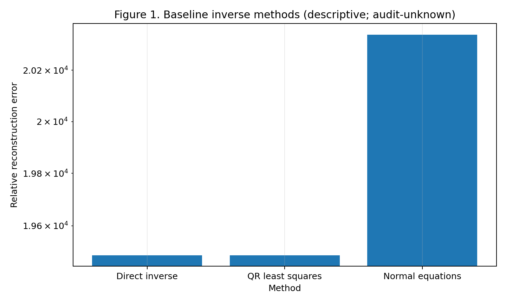
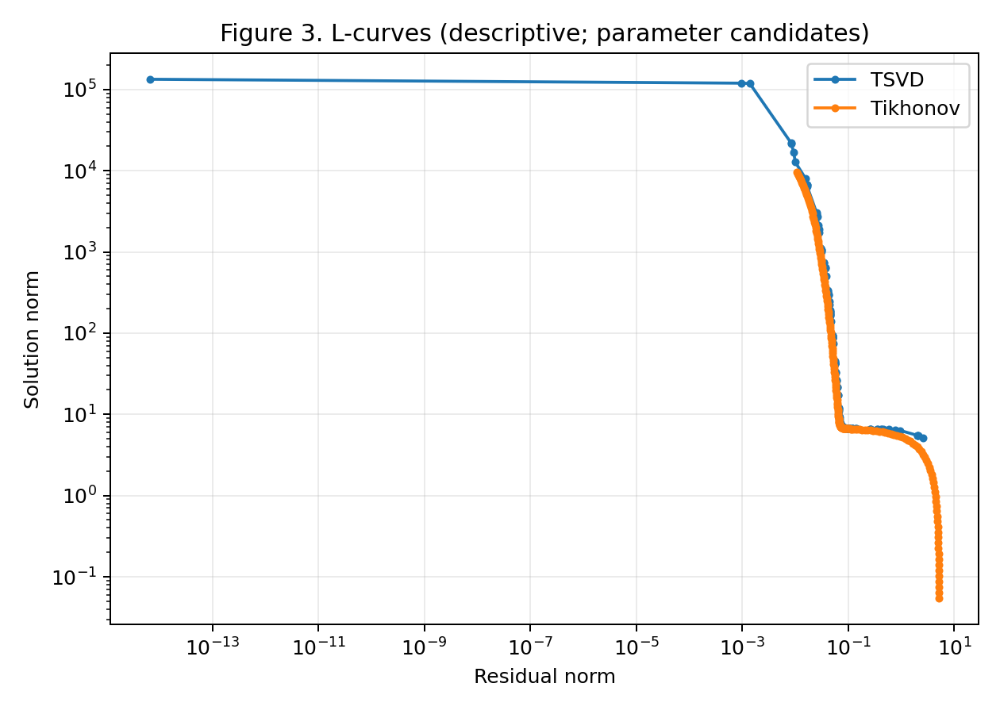
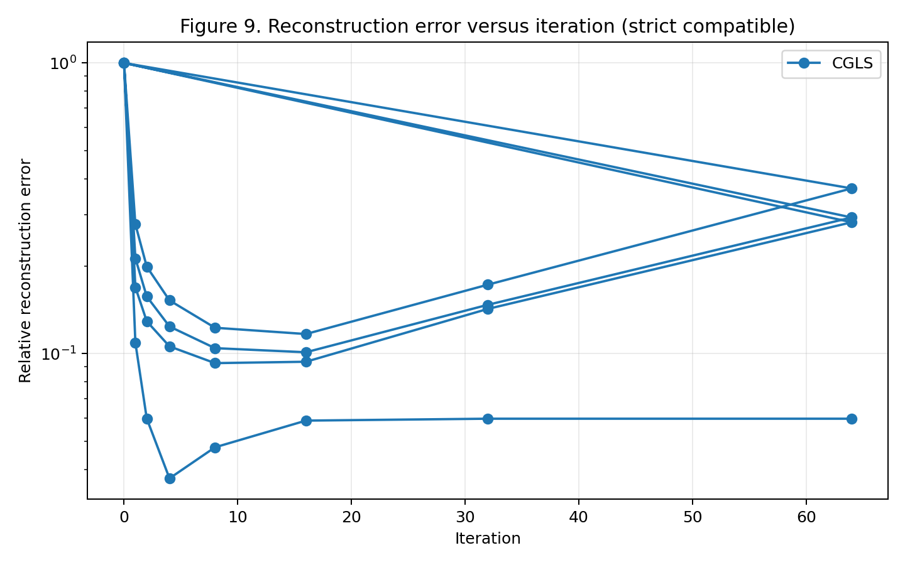
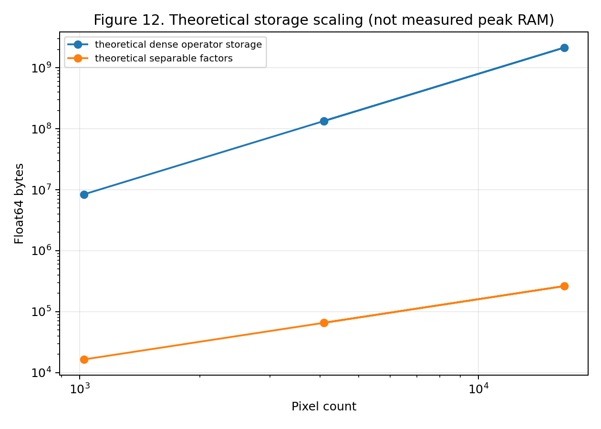

# Image Deblurring as an Ill-Posed Inverse Problem

## Abstract

This project studies `b=Ax+epsilon` for Gaussian-blurred noisy images. It implements direct and least-squares baselines, SVD conditioning analysis, TSVD, L2 Tikhonov, L-curve/GCV/discrepancy selection, sensitivity studies, and matrix-free LSQR, CGLS, and damped LSQR. Saved evidence shows that tiny residuals can coexist with catastrophic reconstruction error, while spectral filtering can stabilize recovery at the cost of bias. Limited images, configurations, and machine-specific timings preclude a universal method ranking.

## Motivation and formulation

For a sharp image `X` of shape `r x c`, `x=vec_C(X)` is C-order vectorized and the observation is `b=Ax+epsilon`. The normalized finite-support Gaussian factors use zero padding; edge-truncated kernels are not renormalized. The implementation applies `Y=B_y X B_x.T`, hence `vec_C(Y)=(B_y kron B_x)vec_C(X)`. Its matrix-free adjoint is `vec_C(B_y.T Z B_x)`. Small singular values make inversion noise sensitive. See [methodology_reference.md](methodology_reference.md) for definitions and equations.

## Methods

Baselines are direct inversion, QR least squares, and normal equations. SVD analysis supplies spectra, numerical rank, condition numbers, Picard coefficients, and noise amplification. TSVD retains leading singular directions. Tikhonov minimizes `||Ax-b||^2+lambda^2||x||^2` through SVD filters and an augmented least-squares formulation. L-curve, GCV, and discrepancy selection use observation/operator information only. LSQR, CGLS, and damped LSQR use matrix-free forward and adjoint actions; their histories expose early stopping and semiconvergence.

## Experimental design and evidence controls

The common source is normalized grayscale camera data resized with Pillow LANCZOS. Dense Phase 2, 4, and 5 studies use 12x12, sigma 1.5, kernel support 9, zero boundary, noise standard deviation 0.01, seed 42, and relative tolerance 1e-12. Phase 6 varies five noise seeds, three blur strengths, and 6x6, 12x12, and 16x16 resolutions. Phase 7 uses matrix-free cases from 32x32 to 128x128.

Phase 8 keeps candidate evaluations, outcomes, aggregates, trajectories, and metadata as distinct record types. Compatibility is purpose-specific: strict comparisons use compatible records, unknown records are descriptive, and incompatible records are excluded. Artifact provenance is indexed in [results_and_figures_index.md](results_and_figures_index.md).

## Results

Phase 2 direct inverse and QR have reconstruction error about `1.95e4` despite near-zero residuals; normal equations have error about `2.03e4`. This descriptive result demonstrates that residual fit is not reconstruction accuracy. Phase 3 records strong spectral conditioning: its 8x8 summary condition number is about `1.77e6`, while the 12x12 Phase 5 investigation reports about `5.68e7` under its stated tolerance.

The saved Phase 4 Tikhonov lambda 0.1 outcome has error `0.18593123130628608`, residual `0.13887152490714016`, and SSIM `0.8554743895927888`. It remains descriptive because its compatibility status is unknown. TSVD-GCV selected rank 142 with residual `0.0013785170153832848` but error `17317.138052621427`; this retained failure is consistent with noise amplification in weak singular directions.

Strict Phase 6 raw-case groups vary noise, blur, and resolution without double-counting aggregate summaries. The normal-equation noise group has mean relative error about `7.45e4`, five unstable unique cases, and small mean residual. Phase 7 has eight strict-compatible equal-budget LSQR/damped-LSQR rows. Its separate trajectories show iteration-dependent reconstruction quality, so continued residual reduction is not necessarily desirable.

## Discussion, limitations, and conclusion

Ill-conditioning turns weak observational noise into large inverse coefficients. TSVD and Tikhonov stabilize solutions by trading detail for reduced variance. Parameter selection is not fail-safe, as the rank-142 TSVD-GCV result demonstrates. Matrix-free methods reduce explicit storage but their saved storage values are theoretical Float64 estimates, not peak RAM, and dense separable factor products remain computationally relevant.

The work uses few images, limited noise realizations and blur/resolution grids, a maximum tested scalable size of 128x128, and machine-specific timings. It therefore supports bounded, evidence-backed conclusions rather than universal superiority. Regularized and carefully stopped iterative methods can be stable under the studied conditions; direct residual minimization alone is not reliable for ill-conditioned deblurring.
