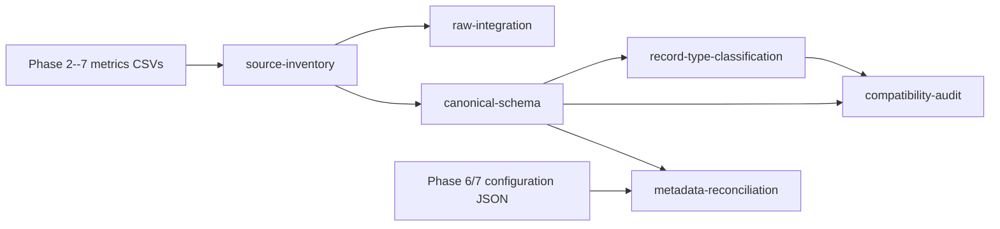

# Phase 8 Pipeline Architecture and Stage Separation (P8-06)

## Purpose

P8-06 separates Phase 8 orchestration from the earlier coupled preliminary
analysis function. It does not alter any Phase 2--7 experiment, scientific
adapter, numerical method, canonical record, classification, compatibility
decision, or metadata reconciliation rule.

The authoritative registry is `src/analysis/phase8_pipeline.py`. It declares
the direct inputs, outputs, and upstream dependencies of every public stage.
`experiments/phase8_integrated_analysis.py` supplies one handler per stage.
The registry validates declared input artifacts before that handler is called.
The former all-in-one plot/report routine remains as
`run_legacy_preliminary_analysis()` for historical provenance, but is no
longer reachable through the CLI.

## Dependency graph



`raw-integration` is a provenance-preserving union only. It is deliberately
not a prerequisite for the canonical schema because the canonical adapter
uses the validated inventory and original source paths directly. This avoids
treating a heterogeneous raw union as a normalized analytical input.

## Stage ownership

| Stage | Required direct inputs | Outputs owned by the stage | Independent use |
|---|---|---|---|
| `source-inventory` | `results/metrics/` Phase 2--7 sources | `phase8_source_inventory.csv` | Yes; it discovers and loads all available sources. |
| `raw-integration` | Source inventory | `phase8_unified_records.csv` | Yes, after inventory; it verifies source rows and columns against inventory provenance. |
| `canonical-schema` | Source inventory | `phase8_canonical_long_form.csv`, `phase8_schema_mapping_audit.csv` | Yes, after inventory. |
| `record-type-classification` | Canonical long form | `phase8_record_type_audit.csv` | Yes, after canonical schema. |
| `compatibility-audit` | Canonical long form, record-type audit | `phase8_compatibility_audit.csv` | Yes, after both inputs exist. |
| `metadata-reconciliation` | Canonical long form, mapping audit, Phase 6/7 config JSON | `phase8_metadata_quality_audit.csv`, `phase8_reconciled_metadata.csv` | Yes, after its listed evidence exists. |

No stage owns Phase 2--7 outputs. No public isolated stage writes plots,
comparison tables, or a narrative report. Those concerns remain outside P8-06
and require their own future stage definitions.

## CLI

From the repository root:

```powershell
python experiments/phase8_integrated_analysis.py --list-stages
python experiments/phase8_integrated_analysis.py --stage source-inventory
python experiments/phase8_integrated_analysis.py --stage raw-integration
python experiments/phase8_integrated_analysis.py --stage canonical-schema
python experiments/phase8_integrated_analysis.py --stage record-type-classification
python experiments/phase8_integrated_analysis.py --stage compatibility-audit
python experiments/phase8_integrated_analysis.py --stage metadata-reconciliation
```

The four previously supported isolated commands are preserved. There is no
default stage. To deliberately recompute every registered core stage in
dependency order, use the explicit command below; it is never selected by an
isolated command.

```powershell
python experiments/phase8_integrated_analysis.py --stage full-core-pipeline
```

## Validation and error handling

Before dispatch, the registry checks every direct input and raises a
`FileNotFoundError` naming the requested stage, missing artifacts, and its
upstream stage(s). A handler then retains its module-level input validation.
Raw integration additionally rejects stale inventory provenance: an included
source must be marked existing and loaded, and its current row count and header
must match the recorded inventory.

The registry is ordered deterministically, and source inventory discovery is
sorted. Individual stage execution calls exactly one registered handler.
Architecture tests use temporary project roots and fake handlers, so validating
dispatch, ownership, missing-input errors, and full-order execution cannot
rewrite project artifacts.

## Artifact-safety rules

- Never run a Phase 2--7 experiment from Phase 8 orchestration.
- An isolated command may only write outputs declared for that exact stage.
- Use `full-core-pipeline` only when intentional replacement of all core
  outputs is wanted.
- Do not use the retained legacy preliminary function for P8-06 work; it
  couples unrelated CSV, plot, and report output generation.
- Confirm current artifact hashes before and after architecture-only changes.

## Limitations and extension points

The registry documents completed evidence-processing stages only. It does not
add P8-04 comparative aggregation or plots, P8-05 independent validation, or
any Phase 9 work. Future analytical or reporting stages should be new
`StageSpec` entries with explicit inputs and outputs, rather than appended to
an existing handler.
